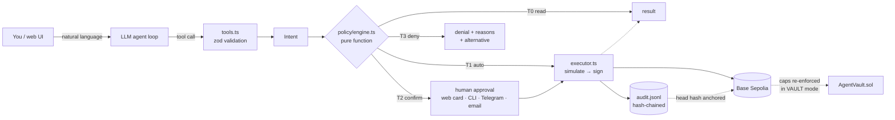
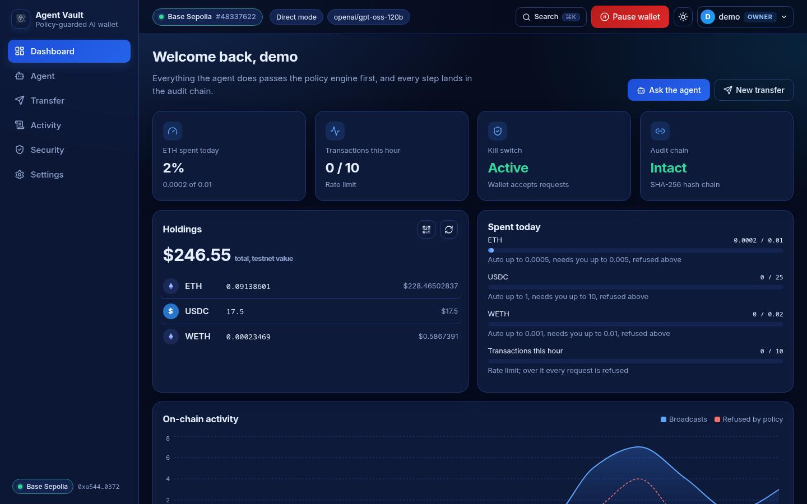
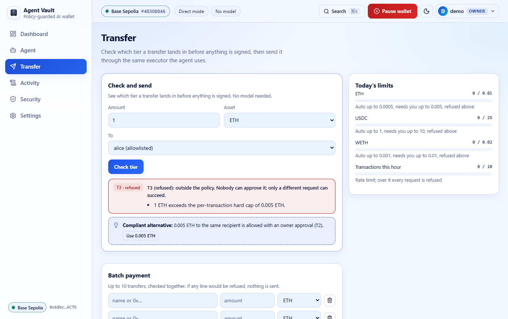
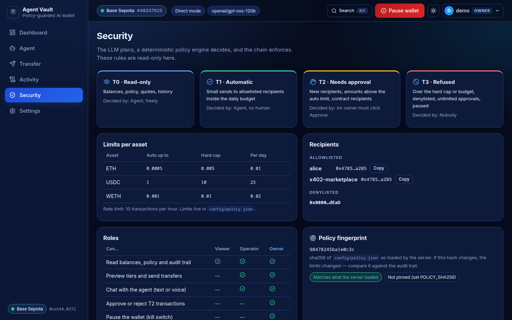
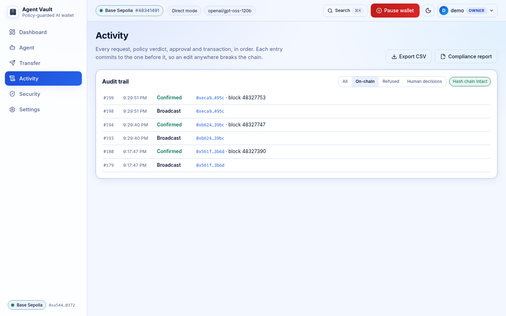

# Agent Vault

[](https://github.com/MARUF-1508/AgentVault/actions/workflows/ci.yml)

-1d4ed8)


**An AI wallet agent you can safely give money to.** It manages assets, executes transactions and controls risk on **Base Sepolia**, and every action passes a deterministic policy firewall the LLM cannot bypass, a human approval when the policy says so, and on-chain caps.

> Shenzhen FinTech International Track, Topic F "Agent Wallet" · team **It_Works_On_My_Machine** · testnet only.
> Judges: start with [the 60-second quickstart](#60-second-quickstart-no-keys), [the evidence](#evidence-at-a-glance) and [the judges' guide](#for-judges-testing-this-project).

**Core idea:** the LLM *plans*, a pure-function policy engine *decides*, the chain *enforces*.



The LLM has **no tool** that can change the policy, limits, allowlists or the
kill switch, and only `executor.ts` holds the signing client.

| Tier | Meaning | Example |
|---|---|---|
| T0 | Read-only, always allowed | balances, policy, history |
| T1 | Auto-execute | ≤ 0.0005 ETH to an allowlisted address, within the daily budget |
| T2 | Human must approve | new recipient, or above the auto limit |
| T3 | Denied | above hard cap, over daily budget, velocity burst, denylisted, unlimited approval, wrong chain, paused |

Every T2/T3 answer explains its tier in one sentence and carries the engine's
**compliant alternative**: the largest amount the same policy accepts, proven
by re-running the engine, or why there is none ("budget resets at 00:00 UTC").

## Screenshots

| Dashboard (dark theme, real Base Sepolia balances) | Transfer: T3 refusal with the engine's compliant alternative (light) |
|---|---|
|  |  |

| Security: tiers, live limits, roles and the policy fingerprint (dark) | Activity filtered to on-chain entries (light) |
|---|---|
|  |  |

### The policy firewall in action

A T1 inside the limits executes with no prompt; the same form then raises the
amount until the engine refuses (T3) and offers the largest amount it would
accept.


A T2 request for an allowlisted recipient above the auto limit becomes a human
approval card with a countdown. Here it is rejected, so nothing is signed.


## 60-second quickstart (no keys)

Needs Node.js 20.19+ (24 recommended, see `.nvmrc`). No wallet, no LLM key, nothing is sent.

```bash
git clone https://github.com/MARUF-1508/AgentVault.git && cd AgentVault
npm install && npm test                                   # 324 unit tests, offline
npm run cli -- preview 0x4785Dca37A242F3D80f844CB0b143A687008a2B5 1   # T3 + the engine's compliant alternative
npm --prefix web install && npm --prefix web run build    # build the web UI
npm run cli -- serve                                      # http://127.0.0.1:5174 → create the owner account
```

Verified from a fresh clone with no `.env`: tests pass, the preview prints T3 with
a 0.005 ETH T2 alternative, and the UI serves with `/api/health` reporting the
Base Sepolia RPC.

## Evidence at a glance

Real Base Sepolia transactions from the team's runs (full table, 20 on-chain
actions and 5 policy refusals: [`docs/EXECUTION_EVIDENCE.md`](docs/EXECUTION_EVIDENCE.md)).

| What | Transaction |
|---|---|
| AgentVault v1 deployed (on-chain caps 0.0005 ETH/tx, 0.01 ETH/day) | [`0x098f7Cb9…` contract](https://sepolia.basescan.org/address/0x098f7Cb9b09cAdB87c2cf8FFa1705a2BD1469388) · [deploy tx](https://sepolia.basescan.org/tx/0xa63dea30909b141cbfd44cb5c256e46559fc78dc15f502dfff1eb69a148a9b27) |
| Agent send within the vault's limits | [`0xfdfbb94d…`](https://sepolia.basescan.org/tx/0xfdfbb94d4c684d5338fa527d9692dbb4d75e83c6fae75175845ec729a8f80212) ✅ |
| Over-cap agent call, **reverted on-chain** | [`0x22da3e42…`](https://sepolia.basescan.org/tx/0x22da3e428ad04d45ebff727dedafd1734a4c8730556765b37f0009f57d921be0) ❌ by design |
| Non-allowlisted agent call, **reverted on-chain** | [`0xd71e8143…`](https://sepolia.basescan.org/tx/0xd71e8143568d1d418149b290ca0ddab5fc4015cebdfe3d5ef608ee47fb24e568) ❌ by design |
| T1 automatic transfer | [`0x40299548…`](https://sepolia.basescan.org/tx/0x40299548ddf85c221936ed4d8429b322e676e244bf835a7a3ccf22e531c62365) ✅ |
| T2 transfer after a human approval | [`0xe0e69dc5…`](https://sepolia.basescan.org/tx/0xe0e69dc5e8395e1e2060318cbec1e85256a74e498252683f9b7f55b7709e2fca) ✅ |
| Bounded Uniswap v3 swap (approve + swap) | [`0x8c85259b…`](https://sepolia.basescan.org/tx/0x8c85259bda1f0829cd23a46591acb4184e0513e08040beaeb19c67207f53c3d5) ✅ |
| Audit head anchored on-chain, verified with `audit verify --onchain` | [`0x561f8a6a…`](https://sepolia.basescan.org/tx/0x561f8a6a4fb66e7d9021ac12359a8288118c1a8558b0803bc47090959cf53b6d) ✅ |
| Two-line batch payment (both T1, both confirmed) | [`0xb6245068…`](https://sepolia.basescan.org/tx/0xb62450685da34f2794f92e1361d8c22e55ed4adfd0c80c28fedc582d3d8c39bc) · [`0xeca94314…`](https://sepolia.basescan.org/tx/0xeca9431472290ff0c1e5d8d663b74245e24ec1b0bcfa46321afdd3f6d214495c) ✅ |
| ERC-4337 account deployed + session-key userOp through EntryPoint v0.7 | [`0x71c45789…` account](https://sepolia.basescan.org/address/0x71c457899cd25f52e4e49dacdcc84f890c1ea98c) · [userOp tx](https://sepolia.basescan.org/tx/0x164877c9b480a2ac77fd5c14540b8df9562340f68f71ab212ae5423576d0d6c1) ✅ |

Tests: 324 unit (vitest) · 13 end-to-end incl. WCAG 2.2 AA (Playwright + axe) ·
69 contract (Foundry), all run in CI on every push.

## What it can do

| Area | Feature | Where |
|---|---|---|
| Transactions | Natural-language transfers (EN / 简体中文), name resolution against the allowlist and an owner-managed **address book** with "did you mean" (never guessed) | `src/agent/`, `src/agent/resolve.ts` |
| | **Batch payments** (up to 10, all-or-nothing at the policy level) | `execute_batch`, `npm run cli -- batch`, Transfer page |
| | **Transaction tracking**: pending / confirmed / reverted with confirmations, late receipts written back to the log | `get_transaction_status`, `npm run cli -- tx`, Activity page |
| | Bounded swaps on Uniswap v3, **rebalancing planner** (each step a policy-checked swap), schedules (optionally run in the background by `serve`) | `src/dex/`, `src/portfolio/rebalance.ts`, `src/schedule/` |
| | x402 v2 pay-per-fetch through the policy engine | `src/x402.ts` |
| Security | Pure policy engine with T0–T3, **velocity guard**, task envelopes, address-risk checks, anomaly guard, kill switch | `src/policy/engine.ts` |
| | Approval card with the **decoded calldata** of the exact tx to sign; approvals answer one request **by id**; optional **Telegram** and **email** approvers (signed one-time links) | `src/executor/decode.ts`, `src/approval/` |
| | Hash-chained audit log, **on-chain anchors** + `audit verify --onchain`, **secret redaction**, **policy file pin** + drift detection, **compliance report** | `src/audit/`, `src/policy/integrity.ts`, `src/report/compliance.ts` |
| | On-chain caps: AgentVault v1 (deployed) and v2 (session keys + ERC-20); **ERC-4337 smart account** (EntryPoint v0.7) whose session keys are scoped to targets, selectors, value caps and expiry | `contracts/`, `src/aa/userop.ts` |
| Availability | RPC fallback transport, per-token fault tolerance, `/api/health`, LLM retries with backoff, per-user API rate limits | `src/chain/client.ts`, `src/web/` |
| Interface | Multipage web app: sign-in with roles and TOTP, MetaMask-style network indicator, batch card, live tx status, voice, light/dark, **WCAG 2.2 AA** (axe in CI) | `web/` |

---

## Setup

### Prerequisites
- Node.js **20.19 or newer**, 24 recommended (`node -v`; the web build needs 20.19+)
- An API key for any OpenAI-compatible LLM endpoint (only needed for `npm run agent`; the CLI works without one)

### 1. Install
```bash
git clone https://github.com/MARUF-1508/AgentVault.git
cd AgentVault
npm install
npm test            # 324 tests, no network needed
```

### 2. Create the agent's testnet wallet
```bash
npm run keygen
```
This creates `.env` from `.env.example`, generates a fresh key, stores it in `.env` (chmod 600, git-ignored) and prints the address. The same action is in the UI: Settings → Wallet → Generate a wallet. **Testnet only. Never put a key that holds real funds here.**

### 3. Fund it
Send a little Base Sepolia ETH to the printed address from any Base Sepolia faucet (Coinbase Developer Platform, Alchemy, QuickNode and others run one). For USDC, use Circle's testnet faucet (faucet.circle.com) and pick Base Sepolia.

```bash
npm run cli -- info             # should show your balance
npm run cli -- balance USDC
```

### 4. Configure the LLM (for chat mode)
Edit `.env`:
```bash
LLM_BASE_URL=https://api.openai.com/v1   # any OpenAI-compatible endpoint
LLM_API_KEY=sk-...
LLM_MODEL=gpt-4o-mini                    # any model with tool calling
```

### 5. Set your policy
Edit `config/policy.json`. Add the addresses you trust to `recipients.allowlist` (label → address). Limits are human-readable decimal strings.

### 6. Or run it with Docker (one command)
```bash
docker compose up --build     # UI on http://127.0.0.1:8787 (loopback only)
```
The port is published on the host's loopback only; `./data` (accounts, audit
log) persists across restarts and `./config` is mounted read-only. `.env` is
never baked into the image — pass it with `env_file` (already wired, optional).

---

## Usage

```bash
npm run agent                                      # chat with the agent
npm run cli -- portfolio                           # all balances with USD value
npm run cli -- preview <to> 0.0001                 # which tier? nothing is sent
npm run cli -- send <to> 0.0001 --dry-run          # policy + simulation, nothing sent
npm run cli -- send <to> 0.0001                    # native ETH
npm run cli -- send <to> 0.5 USDC                  # ERC-20
npm run cli -- approve USDC <spender> 1            # bounded ERC-20 approval
npm run cli -- swap USDC WETH 2 50 --dry-run       # quote + policy, nothing sent (50 bps cap)
npm run cli -- swap USDC WETH 2 50                 # bounded approve + swap on the DEX
npm run cli -- batch payments.json --dry-run       # several transfers, checked together; nothing sent if any is refused
npm run cli -- tx <hash>                           # pending / confirmed / reverted, with confirmations
npm run cli -- pending                             # every broadcast tx still waiting for a receipt
npm run cli -- schedule list                       # show scheduled / conditional rules
npm run cli -- schedule run                        # run any due rules (each through the executor)
npm run cli -- pause                               # kill switch: deny everything
npm run cli -- resume
npm run cli -- audit                               # last 20 audit entries
npm run cli -- audit verify                        # detect tampering
npm run cli -- audit anchor                        # commit the head hash on-chain (zero-value self tx, T1)
npm run cli -- audit verify --onchain [tx…]        # local chain + every on-chain anchor
npm run cli -- policy hash                         # value to pin as POLICY_SHA256
npm run cli -- serve [--port N]                    # web UI on http://127.0.0.1:5174 (loopback only, sign-in)
npm run cli -- user add <name> <role>               # web UI account: owner | operator | viewer
npm run cli -- recipient list                        # allowlist + denylist
npm run cli -- recipient add <label> <address>       # add a known recipient (audited)
npm run cli -- deny add <address>                    # refuse an address outright
npm run cli -- x402 <resource>                     # paid API demo: pay + fetch (needs X402_API_URL)
npm run evidence                                   # docs/EXECUTION_EVIDENCE.md with tx hashes
npm run e2e                                        # Playwright smoke + WCAG 2.2 AA (axe) in both themes
npm run check                                      # typecheck + unit tests + web typecheck + web build
npm run coverage                                   # vitest + v8 coverage report
npm run x402:api                                   # start the local demo paid API (port 8790, see .env.example)
```

Example chat:
```
you › send 0.0002 ETH to alice
  → get_policy({})
  → preview_transaction({"kind":"native_transfer","to":"0x…","amount":"0.0002"})
  → execute_transaction({...})
agent › Sent 0.0002 ETH to alice (T1, auto). Tx: https://sepolia.basescan.org/tx/0x…
```

### Web UI

```bash
cd web && npm install && npm run build
cd .. && npm run cli -- serve          # http://127.0.0.1:5174
```

On first start the UI shows a setup screen: create the first `owner` account and
sign in. After that, owners add teammates with roles from Settings → Team (or
the CLI: `npm run cli -- user add <name> <owner|operator|viewer>`).

A multipage app (Dashboard, Agent, Transfer, Automation, Activity, Security,
Settings) with a blue light and dark theme. It has sign-in with role-based access, chat with
push-to-talk voice input and spoken replies, a tier preview that works without
the LLM, and a T2 approval dialog that only owners can answer. An unanswered
approval is rejected after two minutes. Owners can enable TOTP two-factor
(Settings → Security, with QR code and "sign out all devices"); sessions
expire after 30 idle minutes. The Security page shows the sha256 fingerprint
of the live policy file, Activity can export the audit trail as CSV, and a T2
request raises a desktop notification. The topbar has a pause button; resuming
needs the owner's password again, and both directions are audit-logged. The
server binds loopback only; never expose it. See `web/README.md`.

**Everything the CLI can do is in the UI too** — the same routes the agent uses,
never a shortcut around the policy engine:

| CLI | Web UI |
|---|---|
| `npm run keygen` | Settings → Wallet → Generate / replace the signing key (owner password; takes effect on restart) |
| `pause` / `resume` | Topbar Pause, then Resume signing (owner password) |
| `approve` / `revoke` | Transfer → Allowance (bounded or unlimited, with tier preview) |
| `swap` | Transfer → Swap (quote, bounded approval, policy-checked swap) |
| `schedule list` / `run` | Automation (rules, background-runner status, dry run) |
| `whatif` | Security → Policy simulator (read-only) |
| `x402` | Transfer sidebar → Paid API (when `X402_API_URL` is set) |
| `audit anchor` / `audit verify --onchain` | Security → On-chain audit anchors |
| `recipient` / `deny` / `user` | Settings → Recipients / Address book / Team |

The top bar shows the network and RPC health (click to re-check); if the RPC
is down a banner says what still works and offers a retry. Transfer has a batch
card, Allowance and Swap tabs, and offers the engine's compliant alternative as
a one-click amount;
Activity follows pending transactions until they settle and downloads a
compliance report; Settings has the address book and the signing-key card. The UI is keyboard-operable
end to end (skip link, focus-trapped dialogs, Escape to close), announces
verdicts and results through a live region, and meets WCAG 2.2 AA contrast in
both themes; `e2e/wcag.spec.ts` runs axe-core over every page in CI.

Optional extras (all off by default, see `.env.example`): `SCHEDULER=true` runs
enabled rules in the background, `TELEGRAM_BOT_TOKEN` + `TELEGRAM_CHAT_ID` post
T2 requests to a private chat with Approve/Reject buttons, `SMTP_URL` +
`APPROVAL_EMAIL_TO`/`FROM` mail them with signed one-time approve/reject links
(opening a link only shows a confirmation page; its button decides), `RPC_FALLBACK_URLS`
adds fallback RPCs, and `POLICY_SHA256` pins the policy file.

### On-chain vault mode

With a deployed `AgentVault` holding funds, set in `.env`:

```bash
VAULT=true
VAULT_ADDRESS=0x098f7Cb9b09cAdB87c2cf8FFa1705a2BD1469388
```

Native transfers are then sent as zero-value `agentSend` calls paid out of the
vault, so the per-tx cap, daily limit and allowlist are re-enforced on-chain
(even a stolen agent key is capped). Policy evaluation is unchanged; swaps are
unaffected. `VAULT=true` without `VAULT_ADDRESS` refuses to start.

**Vault v2 — session keys and ERC-20.** `contracts/AgentVaultV2.sol` adds
owner-granted, expiring **session keys** capped below the vault's own limits, plus
an ERC-20 entrypoint. `agentSend` keeps v1's exact signature, so pointing
`VAULT_ADDRESS` at a v2 vault needs no code change; add `VAULT_TOKENS=true` to
route ERC-20 transfers through `agentSendToken` too:

```bash
VAULT=true VAULT_ADDRESS=<v2 address> VAULT_TOKENS=true
```

See `docs/VAULT_V2.md` for the model, invariants, deploy/grant steps and tests.

---

## For judges: testing this project

No credentials are stored in this repo, by design (private keys are never
committed). Everything below is free: testnet faucets, any free
OpenAI-compatible LLM tier, Foundry, Vite.

**Zero-key path (2 minutes, no wallet, no LLM key):**

```bash
npm install && npm test                # 324 unit tests, offline
npm run cli -- preview 0x4785Dca37A242F3D80f844CB0b143A687008a2B5 0.0002   # T1 verdict, nothing sent
npm run cli -- preview 0x4785Dca37A242F3D80f844CB0b143A687008a2B5 1        # T3 verdict + reasons
npm run cli -- audit verify             # tamper check (empty log reads intact)
cat docs/EXECUTION_EVIDENCE.md          # our real testnet hashes + vault reverts
git clone --depth 1 https://github.com/foundry-rs/forge-std lib/forge-std && forge test   # 69 contract tests
```

**Full signing path (about 5 minutes, still free):** follow Setup steps 2–5
above (`npm run keygen`, fund from a Base Sepolia faucet, send 0.0001 ETH to an
address you control). All demo amounts are tiny on purpose. A ready-made
5-minute walkthrough with expected outputs is in [`docs/DEMO.md`](docs/DEMO.md).

**Submission map** (what to read for each scoring criterion):

| Criterion | Where |
|---|---|
| Task completion (40%) | `docs/DEMO.md` (working flow), `src/agent/`, `src/policy/`, `src/executor/`; live hashes in `docs/EXECUTION_EVIDENCE.md` |
| Security & compliance (30%) | `docs/SECURITY_SELF_ASSESSMENT.md` (tiers, controls, known risks R1–R24), `test/` (324 unit + 69 Foundry + Playwright/axe), `contracts/AgentVault.sol`, compliance report (`GET /api/compliance`) |
| Innovation & interaction (30%) | Engine-proven compliant alternatives, EN/中文 agent, batch payments, rebalancing planner, Telegram and email approvals, decoded-calldata approval card, on-chain audit anchors, ERC-4337 session keys, WCAG 2.2 AA UI, tier preview without LLM, counterfactual **what-if** simulator, **task budget envelope**, **stale-allowance cleanup**, voice chat, policy fingerprint, explanation of every decision, x402 **v2** paid-data flow |
| On-chain bonus (0–5) | `AgentVault.sol` limits + live reverted over-limit calls; `AgentVaultV2.sol` session keys + ERC-20; vault-routing mode; x402 payment — with tx hashes in `docs/EXECUTION_EVIDENCE.md`; `SessionKeyAccount.sol` ERC-4337 account (deployed; live session-key userOp through EntryPoint v0.7); on-chain audit anchors |
| Architecture / technical doc | `docs/TECHNICAL.md` |
| Evidence of real runs | `docs/EXECUTION_EVIDENCE.md` (regenerate: `npm run evidence`). The vault, x402, swap, audit-anchor, batch and ERC-4337 userOp hashes there are live; the anchor is also verified by `audit verify --onchain` (see `docs/FINAL_STATUS.md`) |
| Presentation deck (≤ 10 min) | `docs/deck.pdf` (source: `docs/deck.html`) |
| Final status (what is verified, what is left) | `docs/FINAL_STATUS.md` |

---

## Project layout

```
src/
  index.ts                CLI entry (all commands in the Usage block above)
  config.ts               env + policy loading (zod), policy pin, secret registration
  agent/                  LLM tool loop (retries, EN/ZH), tools, recipient resolution, <untrusted> wrapping
  policy/engine.ts        ★ the policy firewall (pure function)
  policy/alternative.ts   engine-proven compliant alternatives
  policy/                 types, spend state, what-if, recipient-list edits, kill switch, file integrity
  executor/               the only signer: policy → simulate → approve → sign → receipt → audit; batches, decoded calls
  approval/               CLI, web (id-checked), Telegram and email approvers
  audit/                  hash-chained log, on-chain anchors, secret redaction
  aa/userop.ts            ERC-4337 v0.7 user operations for the session key
  chain/                  viem clients (mainnet guard, RPC fallback), vault ABIs
  risk/ dex/ prices/      address risk, Uniswap v3, USD valuation
  portfolio/              balances + USD, rebalancing planner
  schedule/               rules, runner, background scheduler
  report/                 evidence doc, daily stats, compliance report
  auth/                   accounts (scrypt), sessions, TOTP, roles
  web/                    loopback-only API server, rate limiter
  x402.ts                 paid-API client (x402 v2), policy-gated payment
contracts/                AgentVault (v1, deployed), AgentVaultV2 (session keys + ERC-20), SessionKeyAccount (ERC-4337)
script/                   Foundry deploy scripts for all three contracts
test/                     vitest unit + integration tests (40 files, 324 tests)
test/contracts/           Foundry tests: AgentVault 12, AgentVaultV2 37, SessionKeyAccount 20 (incl. fuzzing)
e2e/                      Playwright smoke + WCAG 2.2 AA (axe) against the real server and built UI
web/                      Vite + React UI
scripts/                  keygen, evidence, x402 demo API, ERC-4337 hash vector
config/                   policy.json (limits, lists, swap, risk, velocity), schedules.json
.github/workflows/ci.yml  typecheck, tests, UI build, e2e + axe, Foundry, Docker on every push
docs/                     technical doc, security self-assessment, demo script, evidence, final status, deck
```

### Asset management: swaps and schedules

- **Portfolio** (`get_portfolio` tool / `portfolio` command): every policy asset's balance with a USD value. Prices come from a Chainlink feed when one is configured in `policy.prices`, otherwise a clearly-labelled `fixed-testnet-table`. Read-only (T0).
- **Swap** (`execute_swap` tool / `swap` command): a `swap` intent priced by the Uniswap v3 QuoterV2. The engine derives the on-chain minimum output from the quote and the slippage cap, refuses anything above `swap.maxSlippageBps`, and only ever calls the allowlisted router. A bounded approval (exactly `amountIn`, never unlimited) is sent first and only if the current allowance is short, and that approval is itself a policy-checked intent.
- **Scheduled / conditional rules** (`config/schedules.json`): e.g. "send 1 USDC to Alice every Friday" or "move 50% to USDC if ETH drops 5%". Rules are user configuration (there is no LLM tool to write them); `npm run cli -- schedule run` turns each due rule into a normal `Intent` and runs it through the same executor. A rule that already fired today (per the audit log) is skipped. Rules ship disabled — enable them deliberately.
- **Paid data over x402** (`fetch_paid_data` tool / `npm run cli -- x402 <resource>`): asks the paid API pinned by `X402_API_URL`; on a `402` response the payment requirements are zod-validated and paid as a **normal native-transfer intent through the policy engine** (tiers and budgets apply), then the resource is fetched and handed to the model as untrusted data. Run the demo API with `npm run x402:api`. Live payment hash in `docs/EXECUTION_EVIDENCE.md`.

### Risk controls

Every state-changing action is checked against `config/policy.json` → `risk` in addition to the limits, and these findings can only **raise** the tier:

- **Address risk** (`src/risk/address.ts`, applied before T1/T2): is the target a contract (does it have code)? Is it on the local `blocklist`? Does it imitate an allowlisted address by sharing leading/trailing characters (address poisoning)? A block-listed or poisoning address is T3; a non-allowlisted contract is T2 (or T3 if `contractRecipients: "deny"`). The one chain read (`getCode`) happens in the executor; the engine stays a pure function.
- **Portfolio anomaly guard**: a single request whose USD value exceeds `maxActionPctOfPortfolio`% of the whole portfolio is refused (T3). Set it to `0` to disable.
- **Prompt-injection defence** (`src/agent/untrusted.ts`): every tool result is delivered to the model inside `<untrusted>…</untrusted>`, with any forged tags neutralised, and the system prompt marks it as data. `test/injection.test.ts` feeds a hostile memo ("ignore previous instructions…") and proves the policy still refuses the transfer and nothing is sent.

## Tests
```bash
npm test          # 324 unit + integration tests (vitest), offline
npm run typecheck
npm run e2e       # Playwright smoke + WCAG 2.2 AA axe scan (build the UI first)
npm run check     # typecheck + tests + web typecheck + web build
```
Every security claim in `docs/SECURITY_SELF_ASSESSMENT.md` should have a test. Add one with every new rule.

### Contract tests (Foundry)
`contracts/AgentVault.sol` (v1), `contracts/AgentVaultV2.sol` (session keys + ERC-20) and `contracts/SessionKeyAccount.sol` (ERC-4337) enforce limits on-chain, so a stolen key can't exceed them. Their tests live in `test/contracts/` and need [Foundry](https://book.getfoundry.sh/):
```bash
git clone --depth 1 https://github.com/foundry-rs/forge-std lib/forge-std   # once (lib/ is git-ignored)
forge test   # v1: per-tx cap, daily reset, non-agent revert, pause, allowlist, owner-only
             # v2: session caps ≤ vault, expiry, restricted targets fail closed, token limits, reentrancy, fuzz
             # 4337: scope (targets, selectors, caps), expiry via validUntil, revoke, re-grant, malleable sigs, fuzz
```

## Deploying the contracts
The vault is deployed by the **owner** (a key different from the agent's). With [Foundry](https://book.getfoundry.sh/):
```bash
git clone --depth 1 https://github.com/foundry-rs/forge-std lib/forge-std   # once (lib/ is git-ignored)
forge test                                       # 69 contract tests (12 v1 + 37 v2 + 20 ERC-4337 account), no network needed
export AGENT_ADDRESS=0x...                       # the agent's funded key
export VAULT_MAX_PER_TX=500000000000000          # 0.0005 ether
export VAULT_DAILY_LIMIT=10000000000000000       # 0.01 ether
export VAULT_FUNDING=10000000000000000           # optional
forge script script/DeployAgentVault.s.sol \
  --rpc-url https://sepolia.base.org --private-key <OWNER_KEY> --broadcast
```
For the v2 contract (session keys + ERC-20), use `script/DeployAgentVaultV2.s.sol`
and (optionally) `VAULT_RECIPIENT`, `VAULT_TOKEN`, `VAULT_TOKEN_DAILY_LIMIT`. See
[`docs/VAULT_V2.md`](docs/VAULT_V2.md) for granting session keys. The ERC-4337
account deploys with `script/DeploySessionKeyAccount.s.sol` (owner key; optional
session grant mirroring `config/policy.json`, usage in the script header).
Or the one-liner equivalent:
```bash
forge create contracts/AgentVault.sol:AgentVault \
  --rpc-url https://sepolia.base.org --private-key <OWNER_KEY> --broadcast \
  --value 0.01ether \
  --constructor-args <AGENT_ADDRESS> 500000000000000 10000000000000000
```

## Limitations (honest list)

- **Testnet only.** Mainnet is refused by a guard in `src/chain/client.ts`; the agent key is a hot key in `.env`. Never fund it with real value.
- **ERC-20 on-chain coverage is opt-in.** v1 `AgentVault` moves only native ETH. Deploy `AgentVaultV2` and set `VAULT_TOKENS=true` to route ERC-20 transfers through `agentSendToken` under an on-chain token cap; until a v2 vault is deployed, token transfers come from the agent EOA bounded by the off-chain policy only (R16).
- **Address-poisoning detection is a heuristic** (shared leading/trailing hex digits). It can be evaded by a crafted near-miss; new recipients are still T2, so a human sees the full address (R11).
- **Concurrent budgets are safe within one process.** An execution reserves its amount before re-checking and broadcasting, so a second concurrent request cannot spend the same budget; two server processes over one audit log would still race, which is not a supported deployment (R6).
- **The audit log is tamper-evident, not immutable.** `audit anchor` commits the head hash on-chain and `audit verify --onchain` detects a rewritten or truncated log, but anchoring is manual; entries after the latest anchor rely on the local hash chain (R4).
- **USDC and swaps depend on testnet liquidity** (Circle faucet, Uniswap v3 on Base Sepolia); quotes can be far from market (R10).
- **ERC-4337 is deployed on Base Sepolia.** `contracts/SessionKeyAccount.sol` (EntryPoint v0.7, scoped session keys) and `src/aa/userop.ts` are covered by Foundry and vitest tests; the account is live at `0x71c45789…` and a session-key operation has been executed through `handleOps` (`0x164877c9…`, `SessionSpend` + `UserOperationEvent(success=true)`). A bundler-relayed run is optional and uses the same operation.
- **Email approval links work only where the owner's browser reaches the UI** (the server is loopback-only), and anyone holding the email can approve that one T2 while it waits (R23).
- **Telegram approvals trust the configured chat.** Anyone in that chat can approve a T2 (never a T3); keep it private (R19).
- **The rebalancer plans, it does not trade by itself.** Each step is a separate `execute_swap` that the policy may park or refuse; native ETH is not rebalanced.
- Full list with likelihood/impact/mitigation: `docs/SECURITY_SELF_ASSESSMENT.md` §4.

## 中文速览 (Chinese quick look)

Agent Vault 是一个运行在 **Base Sepolia 测试网**上的 AI 钱包代理：大模型只负责“规划”，
一个纯函数策略引擎负责“决策”（T0 只读 / T1 自动 / T2 人工确认 / T3 拒绝），
链上 `AgentVault` 合约作为最终兜底（私钥被盗也无法超过单日限额）。所有动作写入
防篡改哈希链审计日志；策略、限额、白名单和急停开关对模型完全只读。

快速开始：`npm install && npm test`（324 个离线测试）→ `npm run cli -- preview <地址> 0.0002`
（查看 T1/T3 判定，不发交易）→ 按 README Setup 生成密钥并领测试币 → `npm run cli -- serve`
打开本机网页界面（含 T2 审批卡与审计导出）。完整演示脚本见 `docs/DEMO.md`。

新增：代理可用中文对话（中文提问即中文回答）；被拒绝的转账会由策略引擎给出“合规替代方案”
（例如“可改为 0.005 ETH，需要人工审批”）；支持批量转账（任一笔违规则全部不发送）、交易状态跟踪、
地址簿（按名字解析但仍需审批）、速率/突发限制（velocity guard）、审计日志上链锚定
（`audit anchor` / `audit verify --onchain`）、策略文件哈希锁定（`POLICY_SHA256`）、合规报告导出，
以及符合 WCAG 2.2 AA 的无障碍界面。

## Contributing

`AGENTS.md` lists the project rules every change follows: the policy engine stays
a pure function and is the only path to signing, nothing can change limits from
the agent side, testnet only, every rule gets a test, and `npm test && npm run
typecheck` pass before anything is called done.

## Team

**It_Works_On_My_Machine**

| Member | GitHub | Main areas |
|---|---|---|
| MD. Muktadirul Haque Maruf | [@MARUF-1508](https://github.com/MARUF-1508) | agent core, policy engine, executor, AgentVault v1 and its live evidence, web foundations, docs |
| Soumitra | [@Soumitra-32](https://github.com/Soumitra-32) | AgentVaultV2 (session keys + ERC-20), budget reservations, x402 v2, what-if simulator, deck |
| Tanvir Alam Shihab | [@shihab3point14](https://github.com/shihab3point14) | multipage UI, sign-in and roles, voice, final upgrade (security hardening, WCAG 2.2 AA, CI/CD, ERC-4337) |

## License

MIT — see [`LICENSE`](LICENSE). Copyright (c) 2026 It_Works_On_My_Machine.

Third-party components keep their own licenses: the npm dependencies are permissive (viem, zod, react, recharts, vitest and others MIT; `openai` and `typescript` Apache-2.0; `dotenv` BSD-2-Clause; `lucide-react` and `qrcode.react` ISC), and `forge-std` is MIT. Uniswap v3 is called on-chain as an external contract; no third-party source is vendored.
